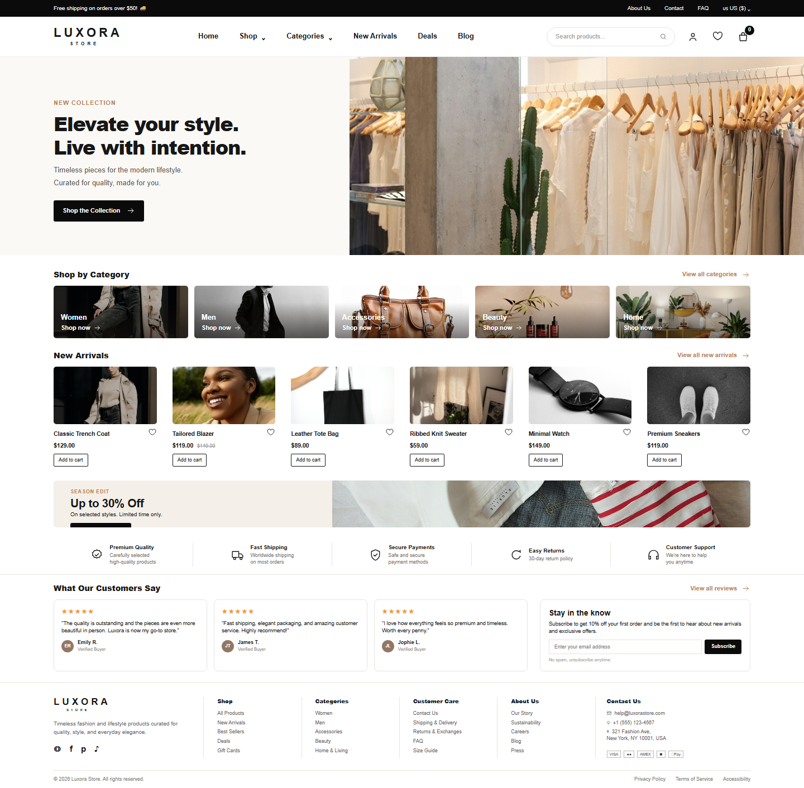
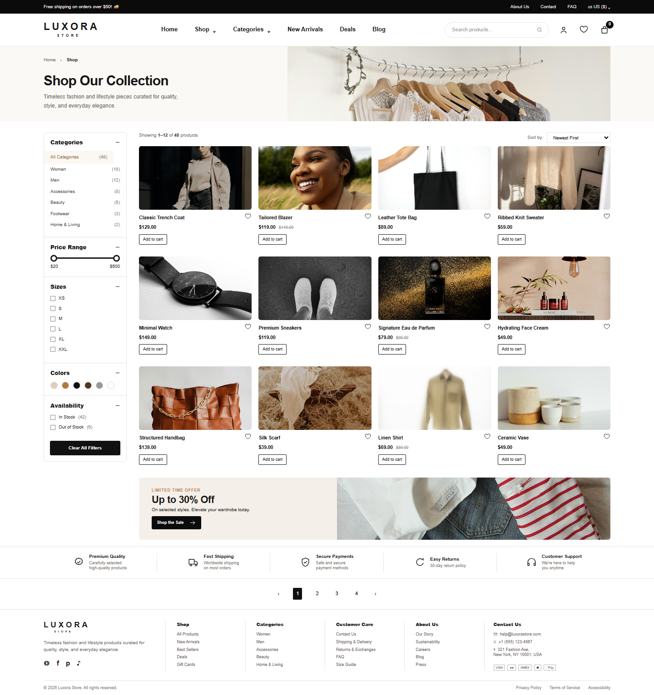
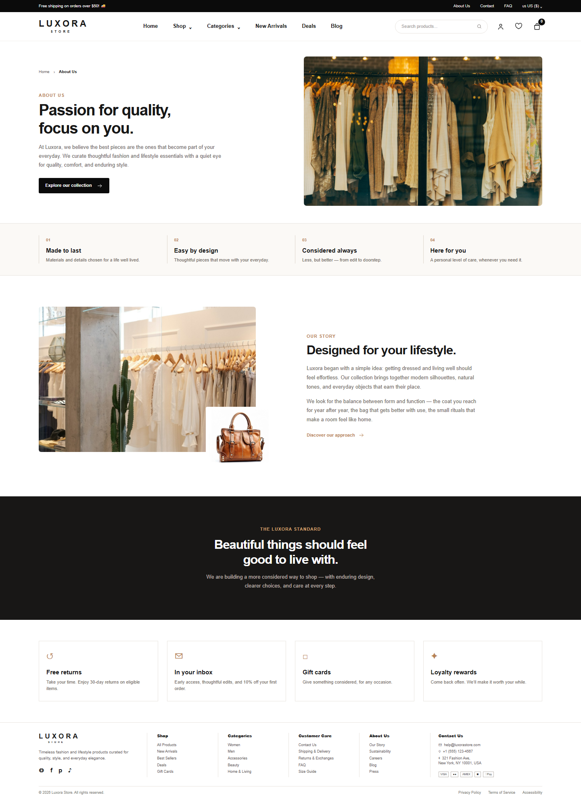
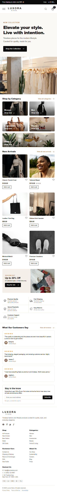
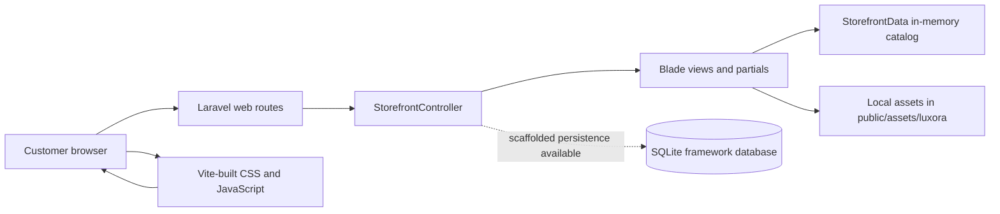

# LUXORA

<div align="center">
  <p><strong>Luxury fashion, translated into a considered digital storefront.</strong></p>
  <p><em>Elevating Fashion Through Digital Experience.</em></p>
  <p>
    <a href="https://www.php.net/"></a>
    <a href="https://laravel.com/"></a>
    <a href="https://vite.dev/"></a>
    <a href="https://tailwindcss.com/"></a>
    <a href="https://www.sqlite.org/"></a>
  </p>
</div>

<div align="center">
  
  <br>
  <sub>Homepage · checked-in browser capture · 1440px viewport</sub>
</div>

## Contents

- [About Luxora](#about-luxora)
- [Website preview](#website-preview)
- [Verified feature scope](#verified-feature-scope)
- [Tech stack](#tech-stack)
- [Architecture](#architecture)
- [Repository structure](#repository-structure)
- [Getting started](#getting-started)
- [Project status and roadmap](#project-status-and-roadmap)
- [Security and quality](#security-and-quality)
- [Assets and licensing](#assets-and-licensing)

## About Luxora

Luxora is a server-rendered fashion and lifestyle storefront shaped around editorial discovery: a calm visual system, curated product cards, neutral imagery and responsive layouts for home, collection and brand-story pages.

The current implementation is intentionally a polished storefront foundation rather than a completed commerce backend. The catalog is represented by verified in-memory demo data, while persistent products, identity flows, orders, payments, inventory and administration remain outside the current scope.

## Website preview

These are real browser captures committed with the project. They document the implemented routes and are not fabricated product or dashboard mockups.

<table>
  <tr>
    <td width="33%"></td>
    <td width="33%"></td>
    <td width="33%"></td>
  </tr>
  <tr>
    <td align="center"><sub>Shop · 1440px</sub></td>
    <td align="center"><sub>About · 1440px</sub></td>
    <td align="center"><sub>Home · 390px</sub></td>
  </tr>
</table>

Additional captures are available for the implemented routes at 375px, 390px, 768px, 1024px and 1440px in [`docs/screenshots/`](docs/screenshots/).

The current evidence set includes a desktop homepage, shop and about view, plus mobile captures. There is no implemented checkout, customer account or admin dashboard to present yet.

## Verified feature scope

The feature list below is based on the routes, Blade views, JavaScript, migrations and data classes present in the repository.

### Customer experience

| Status | Capability | Verified scope |
|---|---|---|
| **Implemented** | Storefront browsing | Homepage, shop collection and about pages are served by named Laravel routes. |
| **Implemented** | Curated product presentation | Twelve product cards are supplied by `StorefrontData`, with local images, category labels, prices and sale prices. |
| **Implemented** | Category filtering | The shop page can filter the rendered cards by category in the browser. |
| **Implemented** | Sorting | The shop page supports newest/default order, price low-to-high and price high-to-low for the rendered cards. |
| **Implemented** | Responsive UI | Header, navigation, hero, grids, filters, benefits, newsletter panel and footer have mobile, tablet and desktop layouts. |
| **Partial** | Search | A search field submits `q` to `/shop`, but the server does not currently apply a search query to the catalog. |
| **Partial** | Cart and wishlist | Cart count, wishlist state and toast feedback are browser-only UI state; there is no persistence or cart route. |
| **Partial** | Newsletter | The form performs client-side email validation and displays feedback; no subscription endpoint or mail integration is connected. |
| **Partial** | Shop filters and pagination | Category filtering and sorting are wired. Size, color, availability and pagination controls are presentation/state interactions only. |
| **Planned** | Product detail | Product-card links currently return to the shop route with a query string; no product detail view exists. |
| **Planned** | Checkout, payments and orders | No checkout flow, payment provider, order model or order history is implemented. |

### Administration and platform

| Status | Capability | Verified scope |
|---|---|---|
| **Implemented** | Blade storefront composition | Shared layout, product card, benefits and icon partials are reused across the storefront views. |
| **Implemented** | Mobile navigation | The menu opens and closes with an `aria-expanded` state and responsive navigation panel. |
| **Implemented** | Basic form semantics | Search and newsletter fields have labels or screen-reader labels, required/email input behavior and live toast feedback. |
| **Partial** | Authentication foundation | Laravel's `User` model, password-reset table and sessions table exist, but login, registration and profile routes are absent. |
| **Planned** | Authorization and roles | No roles, permissions or admin access rules are present. |
| **Planned** | Product, category and inventory management | No product, variant, stock, category or collection tables/models exist. |
| **Planned** | Admin dashboard | No admin route or dashboard view exists. |
| **Planned** | API and external integrations | No application API, payment integration, search service or commerce integration is configured. |

## Tech stack

| Layer | Technology | Purpose and verified scope |
|---|---|---|
| Frontend | Laravel Blade + vanilla JavaScript | Server-rendered pages with lightweight client-side interactions in `resources/js/app.js`. |
| Backend | Laravel 13.35.0 on PHP 8.3.16 | Named web routes, a `StorefrontController` and view composition. |
| Database | SQLite + Laravel migrations | Development database and framework tables for users, sessions, cache and jobs; the storefront catalog is not persisted. |
| ORM | Eloquent | A scaffolded `User` model is present; no commerce models have been added. |
| Styling | Custom CSS and responsive media queries | Design tokens, editorial layout, responsive breakpoints and local asset presentation in `resources/css/`. |
| Tooling | Vite 8.3.4, npm 10.9.2, Playwright 1.64.0 | Frontend bundling and automated browser capture/interaction checks. |
| Testing | PHPUnit 12.5.38 | Two Laravel example tests currently pass; application-specific commerce tests are not present. |

No build-passing, deployment-live or coverage badge is shown because the repository does not provide those external proofs.

## Architecture

Luxora is currently a small Laravel monolith with server-side Blade rendering. The visual catalog is supplied by a PHP data class rather than queried from a product database.



The SQLite connection is available for the Laravel scaffold, but the current storefront requests do not read products, users, orders or inventory from it.

## Repository structure

```text
app/
├── Http/Controllers/StorefrontController.php
├── Models/User.php
└── Support/StorefrontData.php
resources/
├── css/                 # Storefront styles and visual overrides
├── js/app.js            # Client-side storefront interactions
└── views/
    ├── layouts/app.blade.php
    └── luxora/          # Home, shop, about and reusable partials
routes/web.php           # /, /shop and /about
database/
├── migrations/          # Users, sessions, cache and queue tables
├── seeders/DatabaseSeeder.php
└── database.sqlite
public/assets/luxora/    # Local storefront image assets
docs/screenshots/        # Browser captures and visual QA report
scripts/visual-qa.mjs   # Playwright-based route and interaction audit
tests/                   # Unit and feature test suites
config/                  # Laravel application configuration
```

Generated dependencies and build output are intentionally omitted from this overview.

## Getting started

### Prerequisites

- PHP 8.3 or newer within the Laravel constraint.
- Composer.
- Node.js and npm.
- SQLite support enabled in PHP (`pdo_sqlite`/`sqlite3` for the default local setup).

### Install

Clone the repository from the Git remote used for this project, then run the following commands from the project root. A remote URL is not embedded here because no Git remote is available in this workspace.

```bash
composer install
npm ci
```

Create a local `.env` file manually when one is not supplied. Do not commit it. The local setup uses values equivalent to:

```dotenv
APP_NAME="Luxora Store"
APP_ENV=local
APP_DEBUG=true
APP_URL=http://127.0.0.1:8000
DB_CONNECTION=sqlite
DB_DATABASE=/absolute/path/to/database/database.sqlite
```

Generate the application key and initialize the SQLite schema:

```bash
php artisan key:generate --no-interaction
php artisan migrate --seed --no-interaction
```

If the project is run with a fresh SQLite file, create an empty `database/database.sqlite` file before migrating. Keep application secrets, mail credentials and third-party keys in the local environment only.

### Run locally

Use two terminals for the Laravel server and Vite development server:

```bash
php artisan serve
npm run dev
```

Then open `http://127.0.0.1:8000`.

### Build and test

```bash
npm run build
php artisan test --compact
```

For the checked-in browser audit, start the Laravel server on port 8000 and run:

```bash
npm run visual:qa
```

The audit uses the installed Microsoft Edge executable through Playwright and writes route captures plus the machine-readable report to `docs/screenshots/`.

## Project status and roadmap

### Completed and verified

- [x] Laravel 13 storefront shell with `/`, `/shop` and `/about` routes.
- [x] Responsive editorial layout with local imagery and reusable Blade partials.
- [x] Browser interactions for category filtering, sorting, cart count, wishlist state, newsletter feedback and mobile navigation.
- [x] `php artisan test --compact` passes the two currently defined tests.
- [x] `npm run build` completes successfully.
- [x] `npm run visual:qa` passes the current route, image, overflow and interaction checks across five viewport sizes.

### In progress or blocked

- [ ] Replace or approve provisional image assets for commercial use.
- [ ] Supply original reference screenshots before claiming pixel-level visual parity.
- [ ] Replace the in-memory catalog with approved product data and domain rules.

### Planned

- [ ] Product, category, collection and variant persistence.
- [ ] Server-side search, filtering, availability and pagination.
- [ ] Authentication, profiles, roles and authorization.
- [ ] Persistent cart, checkout, payments, orders and order history.
- [ ] Inventory operations and an admin dashboard.
- [ ] Application-specific feature tests and accessibility/performance audits.

## Security and quality

- The Laravel `User` model uses the framework's hashed password cast, and the default migrations include users, password-reset tokens and sessions.
- The application uses Laravel's web routing stack; no custom state-changing commerce endpoint is currently present to exercise an application CSRF flow.
- Browser capture checks currently report HTTP 200 responses, no console errors, no broken images, no duplicate product image sources and no horizontal overflow for the three implemented routes.
- Only two scaffold/example PHPUnit tests exist today. No security review, PCI assessment or production-readiness claim is made.
- The project has no verified CI workflow, deployment configuration or live demo in this workspace.

## Assets and licensing

Storefront images are local files under [`public/assets/luxora/`](public/assets/luxora/). Their source IDs, placements and current verification status are tracked in [`docs/IMAGE_ASSET_MANIFEST.md`](docs/IMAGE_ASSET_MANIFEST.md).

The manifest marks the current image set as provisional and requiring commercial-rights confirmation. Do not treat the present asset set as production-cleared until those rights are verified or the files are replaced.

## Evidence

- [`LUXORA_MASTER_REPORT.md`](LUXORA_MASTER_REPORT.md) — implementation and visual audit notes.
- [`docs/screenshots/report.json`](docs/screenshots/report.json) — latest machine-readable browser QA result.
- [`docs/screenshots/VISUAL_DIFF_REPORT.md`](docs/screenshots/VISUAL_DIFF_REPORT.md) — reference-comparison limitation and visual QA scope.

## License status

No standalone `LICENSE` file is present in this workspace. Although `composer.json` declares `MIT`, this README intentionally does not make a separate licensing claim for the application.

<div align="center">
  <br>
  <strong>LUXORA — A Refined Fashion Commerce Experience.</strong>
  <br><br>
  <sub>Built as a considered storefront foundation.</sub>
</div>
